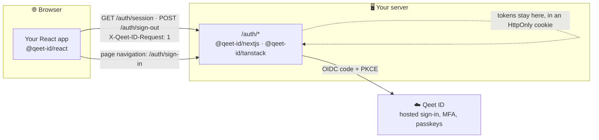

<div align="center">

# ⚛️ Qeet ID for React

**Sign people in on Qeet ID's hosted pages and show the session your own server keeps: a provider, hooks and accessible components for any React app.**

[](#-install)
[](#-typescript-and-modules)
[](#-server-rendering-and-server-components)
[](#-typescript-and-modules)
[](package.json)
[](test)

[📜 Session contract](docs/session-contract.md) · [🚀 Quick start](#-quick-start) · [🧩 Components](#-components) · [📝 Changelog](CHANGELOG.md) · [🏗️ Architecture](docs/architecture/ARCHITECTURE.md)

</div>

> [!IMPORTANT]
> The browser never holds a token and never calls Qeet ID. People sign in on Qeet ID's hosted pages;
> your server keeps the tokens in an encrypted, HttpOnly cookie and answers a few routes under `/auth`.
> [`@qeet-id/nextjs`](https://github.com/qeetgroup/qeet-id-nextjs) and
> [`@qeet-id/tanstack`](https://github.com/qeetgroup/qeet-id-tanstack) provide those routes; any other
> server can, by following the [session contract](docs/session-contract.md).

## 📦 What's inside

| | |
|:--|:--|
| 🔐 **No tokens in the browser** | The backend-for-frontend pattern of RFC 10017: the session is read from your own `/auth/session`, every request carries a CSRF header, and return paths stay on your site |
| 🪝 **Hooks** | `useSession`, `useUser`, `useOrganization`, `useQeetID`, each re-rendering only when its own part of the session changes |
| 🧩 **Components** | `SignedIn` · `SignedOut` · `Protect` · `SignInButton` · `SignUpButton` · `SignOutButton` · `UserButton` · `OrganizationSwitcher` |
| 🔄 **Always current** | Checks again on focus, on reconnection and at expiry; signing out in one tab signs out every tab; tells you why a session ended |
| 🖥️ **Server rendering** | `initialSession` renders the right UI on the server with no flicker and no hydration mismatch; `"use client"` sits exactly where it's needed |
| 🏢 **B2B ready** | The active organisation, the person's roles and permissions in it, and switching between organisations |
| ♿ **Accessible** | WAI-ARIA menu buttons with full keyboard support, live status, right-to-left layouts, every string localisable, checked with axe |
| 🎨 **Your design system** | Wraps your own button; an optional stylesheet that matches Qeetrix by itself; no inline styles, so a strict CSP just works |
| 🧪 **Testable** | `@qeet-id/react/testing` renders your components with any session, no server needed |
| 🪶 **Lean** | React is the only peer; no runtime dependencies; ES module and CommonJS, one file per module for tree shaking |

## 🔗 How it fits



## 📥 Install

React 18.3 or 19. Node.js 22.12 or later to build and server-render.

```sh
npm install @qeet-id/react
# or: bun add @qeet-id/react · pnpm add @qeet-id/react · yarn add @qeet-id/react
```

## 🚀 Quick start

Wrap the app once, then show what fits the session:

```tsx
import { QeetIDProvider, SignedIn, SignedOut, SignInButton, UserButton } from "@qeet-id/react";
import "@qeet-id/react/styles.css"; // optional

export function App() {
  return (
    <QeetIDProvider>
      <header>
        <SignedOut>
          <SignInButton />
        </SignedOut>
        <SignedIn>
          <UserButton showName menuItems={[{ label: "Your account", href: "/account" }]} />
        </SignedIn>
      </header>
    </QeetIDProvider>
  );
}
```

`<SignInButton>` sends the page to `/auth/sign-in?returnTo=<this page>`; your server continues to Qeet
ID's hosted sign-in and brings the person back. The provider reads `GET /auth/session` and every
component follows.

**Server-rendered apps** pass the session the server already has, so the first paint is right:

```tsx
// app/layout.tsx — a Server Component
import { QeetIDProvider } from "@qeet-id/react";
import type { Session } from "@qeet-id/react/contract";

declare function getSession(): Promise<Session | null>; // from your server SDK

export default async function RootLayout({ children }: { children: React.ReactNode }) {
  const session = await getSession();
  return (
    <html lang="en-IN">
      <body>
        <QeetIDProvider initialSession={session}>{children}</QeetIDProvider>
      </body>
    </html>
  );
}
```

## ⚙️ The provider

```tsx
<QeetIDProvider
  initialSession={session}
  basePath="/auth"
  localization={{ signIn: "Log in" }}
  onSessionChange={(session, previous) => {
    if (session?.organization?.id !== previous?.organization?.id) queryClient.clear();
  }}
  onSignOut={(reason) => reason === "expired" && toast("Your session expired. Sign in again.")}
  onError={(error) => logger.warn(error.code, error.message)}
>
```

| Prop | Default | |
|:--|:--|:--|
| `initialSession` | none | The session the server rendered the page with (`Session` or `null`). Without it the provider asks `GET {basePath}/session` on load |
| `basePath` | `/auth` | Where your server's session routes live; must match the server |
| `refetchOnWindowFocus` | `true` | Check again when the tab regains focus (at most every 5 s) |
| `refetchOnReconnect` | `true` | Check again when the browser comes back online |
| `syncTabs` | `true` | Tell other tabs about a sign-out or a switch, and listen to theirs |
| `localization` | English | Any of the component strings; `{name}` and `{organization}` are filled in |
| `onSessionChange` | none | `(session, previousSession)` after the session changes; clear data caches here |
| `onSignOut` | none | `(reason)` when a known session ends: `signed-out`, `expired` or `revoked` |
| `onError` | none | `(error)` when a check or action fails, or the callback reported a failed sign-in |

## 🪝 Hooks

| Hook | Returns | Re-renders when |
|:--|:--|:--|
| `useSession()` | `status`, `isLoaded`, `isSignedIn`, `session`, `user`, `organization`, `error`, `endReason`, `pendingAction`, `has()`, and every action | anything changes |
| `useUser()` | `{ isLoaded, user }` | the person changes |
| `useOrganization()` | `{ isLoaded, organization, roles, permissions, has, switchOrganization, isSwitching }` | the organisation, roles or permissions change |
| `useQeetID()` | `signIn`, `signUp`, `signOut`, `switchOrganization`, `refresh`, `routes` | never: the actions keep their identity |

```tsx
import { useSession } from "@qeet-id/react";

function AccountStatus() {
  const { status, user, endReason, refresh } = useSession();
  if (status === "loading") return <Spinner label="Checking your session" />;
  if (status === "unavailable") return <button type="button" onClick={() => refresh()}>Try again</button>;
  if (status === "signed-out") return endReason === "expired" ? <p>Your session expired.</p> : null;
  return <p>Signed in as {user?.name ?? user?.email}</p>;
}
```

The session has the shape of the [contract](docs/session-contract.md#the-session):

```ts
interface Session {
  user: { id: string; email: string | null; emailVerified: boolean; name: string | null; picture: string | null };
  organization: { id: string; name: string | null } | null;
  roles: readonly string[];       // role names in the organisation, such as "Finance approver"
  permissions: readonly string[]; // permission keys, such as "invoice.approve"
  expiresAt: string;              // ISO 8601
}
```

## 🧩 Components

| Component | Does |
|:--|:--|
| `<SignedIn>` · `<SignedOut>` | Render their children only once the server has answered, signed in or signed out |
| `<Protect>` | A guard for a page or a part of one: `role`, `permission`, `condition`, with `fallback`, `loading` and `redirectToSignIn` |
| `<SignInButton>` · `<SignUpButton>` | Start signing in or up on Qeet ID's hosted pages, back to `returnTo` (this page by default) |
| `<SignOutButton>` | Sign out here and in every tab, then follow the server through Qeet ID's sign-out |
| `<UserButton>` | The avatar, opening a menu with the name, email, your own items and Sign out |
| `<OrganizationSwitcher>` | The active organisation, opening a menu of the others to switch to |

**Your own button.** A trigger renders a plain `<button>`, or gives the click to your design system's
button when it is the single child. Its ref, class and handlers are kept, and `event.preventDefault()`
in its own `onClick` cancels:

```tsx
<SignInButton returnTo="/invoices">
  <Button variant="primary">Review invoices</Button>
</SignInButton>

<SignUpButton loginHint="meera@brightleaffoods.in">Create an account</SignUpButton>
<SignOutButton returnTo="/goodbye" />
```

**Guards.** `<Protect>` works with any router, because sign-in is a server route:

```tsx
<Protect redirectToSignIn loading={<PageSkeleton />}>
  <InvoicesPage />
</Protect>

<Protect permission="invoice.approve" fallback={<p>Ask a finance approver.</p>}>
  <ApprovalQueue />
</Protect>

// Send signed-out people to a page of your own with your router's component:
<Protect fallback={<Navigate to="/welcome" />}>{/* React Router, TanStack Router … */}</Protect>
```

**Organisations.** The app supplies the organisations to offer; Qeet ID doesn't give applications a
person's list of organisations yet:

```tsx
<OrganizationSwitcher organizations={organizations} afterSwitchUrl="/dashboard" />
```

`afterSwitchUrl` loads a page after the switch, so no cached data of the old organisation survives.
Without it the session changes in place and `onSessionChange` fires.

## 🏢 Roles and permissions

```tsx
const { has } = useOrganization();

{has({ permission: "invoice.approve" }) && <ApproveButton />}
{has({ role: "Finance approver" }) && <QuarterEndReport />}
```

> [!WARNING]
> Roles and permissions decide what the page **shows**, never what a person **may do**. The
> component's code still reaches the browser; your server checks every request it answers.

## 🔄 Session states

| `status` | Means | `<SignedIn>` | `<SignedOut>` | `<Protect>` |
|:--|:--|:--|:--|:--|
| `loading` | the first check is on its way | — | — | `loading` |
| `signed-in` | your server reported a session | ✅ | — | children or `fallback` |
| `signed-out` | your server reported none | — | ✅ | `fallback`, or sign-in |
| `unavailable` | the first check failed (`error` says why) | — | — | `loading` |

A later failed check keeps the last known session and sets `error`. When a session ends,
`endReason` says why: `signed-out` (here or in another tab), `expired` (it reached `expiresAt`) or
`revoked` (it ended on the server first). `pendingAction` is `sign-out` or `switch-organization` while
the server answers; the components show it with `aria-busy`.

## 🎨 Styling

Import the optional stylesheet once. Nothing loads it for you:

```tsx
import "@qeet-id/react/styles.css";
```

Every value is a custom property with layered fallbacks, `var(--qeet-id-…, var(--qx-…, <Qeet
default>))`, so an app that loads Qeetrix's tokens matches Qeetrix without doing anything:

```css
:root {
  --qeet-id-color-focus: #0b6bcb;
  --qeet-id-radius-popover: 12px;
  --qeet-id-font-family: "Inter", system-ui, sans-serif;
}
```

| | |
|:--|:--|
| 🌗 **Dark mode** | Follows `prefers-color-scheme`; `data-theme="dark"` or `"light"` on any ancestor wins |
| 🧱 **Cascade layer** | Everything is in `@layer qeet-id`, so your own rules win without specificity fights |
| 🏷️ **Classes** | BEM: `qeet-id-user-button__trigger`, `qeet-id-organization-switcher__item`; `data-state="open"` |
| ✂️ **Your own** | `className` on the root, `classNames={{ trigger, menu, item, … }}` per part, `unstyled` to drop the SDK's classes |
| 🛡️ **CSP** | No inline styles and nothing injected: a strict `Content-Security-Policy` needs no exception |
| ↔️ **Right to left** | Logical properties throughout |

## 🌍 Localisation and accessibility

Every string is on the provider:

```tsx
<QeetIDProvider
  localization={{
    signIn: "साइन इन करें",
    signOut: "साइन आउट करें",
    userButtonLabel: "{name} का खाता",
    organizationSwitching: "{organization} पर जा रहे हैं…",
  }}
>
```

`UserButton` and `OrganizationSwitcher` follow the WAI-ARIA menu button pattern: Enter, Space and the
arrow keys open the menu with focus inside; arrows wrap; Home and End jump; typing a letter finds an
item; Escape closes and returns focus. Organisations are radio items with the current one checked,
and a switch is announced in a live region. Avatars fall back from the picture to initials to an icon.

## 🖥️ Server rendering and Server Components

- **`initialSession`** makes the server's HTML and the first client render agree, signed in or out,
  with no request on load.
- **`"use client"` is on each module that needs it**, not on the entry, so a Server Component can
  import `QeetIDError`, `VERSION`, the types and `@qeet-id/react/contract` directly, and render
  `<QeetIDProvider>` with plain-data props.
- **Callbacks** (`onSessionChange`, …) are functions, so set them from a Client Component.
- **No module-level state**: a server rendering many people's pages never mixes their sessions.

## 🧪 Testing your app

```tsx
import { render, screen } from "@testing-library/react";
import { QeetIDTestProvider, createTestSession } from "@qeet-id/react/testing";

it("hides approvals from people who can't approve", () => {
  render(
    <QeetIDTestProvider session={createTestSession({ permissions: ["invoice.read"] })}>
      <InvoiceToolbar />
    </QeetIDTestProvider>,
  );
  expect(screen.queryByRole("button", { name: "Approve" })).not.toBeInTheDocument();
});
```

| Prop | |
|:--|:--|
| `session` | A `Session` (from `createTestSession`), or `null` for signed out (the default) |
| `status` | `"loading"` or `"unavailable"` instead |
| `onNavigate` | Receives every navigation (sign-in URL, sign-out redirect) instead of the page moving |
| `onSwitchOrganization` | Answers a switch with a session, or throws to fail it |
| `signOutError` | Fails sign-out with this error |

## 🔐 Security

| | |
|:--|:--|
| 🔑 **No tokens** | Nothing in script, `localStorage` or `sessionStorage`; no `getToken()` |
| 🛡️ **CSRF** | Every request sends `X-Qeet-ID-Request: 1`; servers refuse a `POST` without it |
| ↩️ **Return paths** | Same-origin paths only: other sites, `//host`, `/\host` and other schemes are refused on both sides |
| 🔗 **Navigation** | Only `http(s)` URLs and paths are followed; a `javascript:` URL never runs |
| 🧾 **CSP** | No inline styles, scripts or `eval` |
| 🖼️ **Avatars** | Loaded with `referrerPolicy="no-referrer"` |

## 🚨 Errors

Every failure is a `QeetIDError`. Branch on `code`, never on `message`:

| `code` | When |
|:--|:--|
| `network_error` | no answer came |
| `session_unavailable` | your server couldn't reach Qeet ID (503) |
| `csrf_rejected` | a request without the CSRF header, or from another site (403) |
| `organization_switch_refused` · `organization_switch_unavailable` | the switch was refused (403) or isn't possible (501) |
| `not_signed_in` · `invalid_request` · `method_not_allowed` · `internal_error` | as their names say |
| `invalid_response` | the answer wasn't the contract's JSON, usually a route that isn't mounted |
| `http_<status>` | an answer without a code (`http_404`: no route at that path) |
| `access_denied`, `login_required`, `invalid_state`, … | the callback reported a failed sign-in |

## 🛠️ TypeScript and modules

| Import | Use it in | Contents |
|:--|:--|:--|
| `@qeet-id/react` | Client and Server Components | provider, hooks, components, `QeetIDError`, `VERSION`, types |
| `@qeet-id/react/contract` | anywhere, servers included | `Session` and the other contract types, `sessionRoutes`, `safeReturnTo`, `parseSession`, `CSRF_HEADER` |
| `@qeet-id/react/testing` | tests and stories | `QeetIDTestProvider`, `createTestSession` |
| `@qeet-id/react/styles.css` | your CSS entry | the optional stylesheet |

ES module and CommonJS builds with their own declarations, one file per module, `sideEffects` limited
to the stylesheet. Checked with `publint` and Are the Types Wrong in every resolution mode.

## 📚 Learn more

| | |
|:--|:--|
| 📜 [Session contract](docs/session-contract.md) | The routes, JSON and rules your server implements, and where each field comes from in Qeet ID |
| 🏗️ [Architecture](docs/architecture/ARCHITECTURE.md) | How the store, provider, hooks and components fit |
| 🧭 [Engineering practices](docs/engineering-practices.md) | What comparable SDKs do, what this one ships and why, with sources |
| 🗂️ [Design decisions](docs/design-decisions) | ADR-0001 to ADR-0005 |
| 🔭 [Future work](docs/FUTURE.md) | What waits for Qeet ID, and what may come |

## 🤝 Contributing

See [CONTRIBUTING.md](CONTRIBUTING.md). `bun install`, then `bun run verify` runs every check.

## 🛡️ Reporting a vulnerability

Email **security@qeet.in**; see [SECURITY.md](SECURITY.md).
