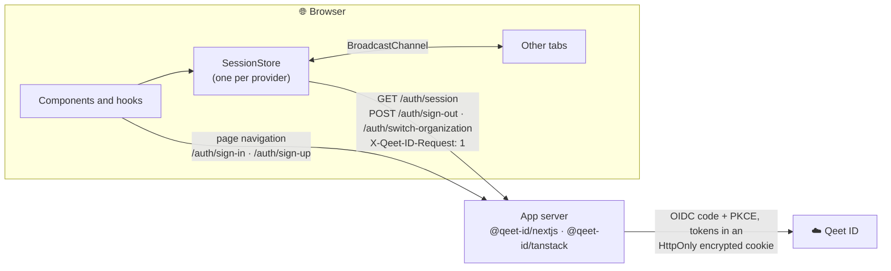

# Architecture

`@qeet-id/react` is the browser half of a backend-for-frontend integration (ADR-0001). It renders the
session the app's server reports and sends people to the server's routes; it never calls Qeet ID and
never holds a token.



## Layers

```text
src/index.ts                 the public entry; no "use client" (re-exports only)
src/contract.ts              the session contract: types, routes, safeReturnTo, parseSession (no React)
src/errors.ts, version.ts    QeetIDError, VERSION (no React)

src/core/                    framework-free
  store.ts                   SessionStore: state, checks, actions, listeners, expiry timer
  transport.ts               fetch to the session routes; contract validation; QeetIDError mapping
  navigation.ts              return paths, sign-in URLs, the only-http(s) navigation
  tabs.ts                    the BroadcastChannel wrapper
  access.ts                  hasAccess: roles and permissions as display hints
  development.ts             isDevelopment, warnOnce

src/provider/                "use client" where React is used
  QeetIDProvider.tsx         creates the store, starts it, hydrates newer server renders
  context.ts                 the shared context (one per React copy, across ESM and CJS)
  localization.ts            the strings and {placeholder} formatting (no React)

src/hooks/                   useSession, useUser, useOrganization, useQeetID, useStoreState
src/components/              SignedIn, SignedOut, Protect, Sign{In,Up,Out}Button, UserButton, OrganizationSwitcher
  internal/                  Trigger (single-child button), useMenuButton (APG), Avatar, icons, classNames
src/testing/                 QeetIDTestProvider, createTestSession (entry: src/testing.ts)
src/styles.css               the optional stylesheet, copied to dist as is
```

## Data flow

1. `<QeetIDProvider>` creates a `SessionStore` in `useState` (no side effects) with the routes under
   `basePath`, the `fetch` transport and `initialSession`.
2. Its effect calls `store.start()`: listeners for focus, `online` and other tabs, the callback's
   `authError`, the first check when the session isn't known, and the expiry timer. Cleanup calls
   `stop()`.
3. Hooks read the store with `useSyncExternalStore`, each selecting its part.
4. Actions go through the store: `signIn`/`signUp` navigate; `signOut` and `switchOrganization` post,
   update the state, tell other tabs, call the callbacks and (sign-out) navigate to `redirectTo`.

## State

| Status | Means | `<SignedIn>` | `<SignedOut>` | `<Protect>` |
| :-- | :-- | :-- | :-- | :-- |
| `loading` | the first check is on its way | nothing | nothing | `loading` |
| `signed-in` | the server reported a session | children | nothing | children or `fallback` |
| `signed-out` | the server reported none | nothing | children | `fallback`, or a redirect |
| `unavailable` | the first check failed | nothing | nothing | `loading` |

`error`, `endReason` and `pendingAction` complete the snapshot (`src/core/store.ts`).
