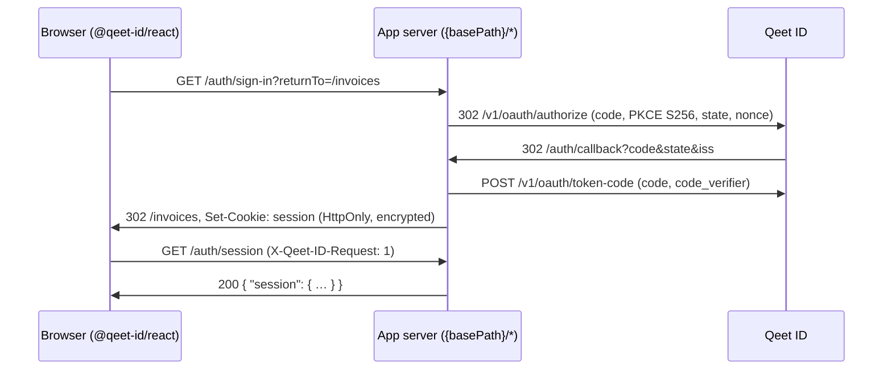

# The session contract

What `@qeet-id/react` in the browser and the app's own server agree on. `@qeet-id/nextjs` and
`@qeet-id/tanstack` implement the server side; any other server can, by following this page.

The types and helpers are in [`src/contract.ts`](../src/contract.ts), published as
`@qeet-id/react/contract`: no React, no `"use client"`, safe on any server.

```ts
import { type Session, CSRF_HEADER, parseSession, safeReturnTo, sessionRoutes } from "@qeet-id/react/contract";
```

## The model

People sign in on Qeet ID's hosted pages (OpenID Connect authorization code with PKCE). The app's
server is the OAuth client: it exchanges the code, keeps the tokens in an encrypted, HttpOnly cookie
session, and tells the browser who is signed in. The browser never holds a token and never calls
Qeet ID. This is the backend-for-frontend pattern of
[RFC 10017 §6.1](https://www.rfc-editor.org/rfc/rfc10017.html#section-6.1).



## Routes

Every route lives under a base path, `/auth` unless the app configures another
(`<QeetIDProvider basePath="/account/auth">` in the browser, the same value on the server).
`sessionRoutes(basePath)` returns the six paths.

| Route | Method | Called by | Request | Success |
|:--|:--|:--|:--|:--|
| `{base}/sign-in` | GET, a page navigation | the browser | `?returnTo=&organization=&loginHint=` | `302` to Qeet ID's `/v1/oauth/authorize` |
| `{base}/sign-up` | GET, a page navigation | the browser | `?returnTo=` | `302` to Qeet ID's `/v1/oauth/authorize` |
| `{base}/callback` | GET, a page navigation | Qeet ID's redirect | `?code=&state=&iss=`, or `?error=&state=` | `302` to the saved return path |
| `{base}/session` | GET, `fetch` | the browser | header `X-Qeet-ID-Request: 1` | `200` `SessionResponse` |
| `{base}/sign-out` | POST, `fetch` | the browser | header, optional JSON `SignOutRequest` | `200` `SignOutResponse` |
| `{base}/switch-organization` | POST, `fetch` | the browser | header, JSON `SwitchOrganizationRequest` | `200` `SwitchOrganizationResponse` |

### `GET {base}/sign-in`

Starts an authorization request at Qeet ID's `/v1/oauth/authorize`: `response_type=code`,
`code_challenge` with `code_challenge_method=S256`, a fresh `state` and `nonce`, the app's
`redirect_uri` (`{origin}{base}/callback`) and scopes. Ask for `openid email profile`: the session's
fields come from them. The server keeps the PKCE verifier, `state`, `nonce` and the checked return
path in a short-lived, HttpOnly, encrypted cookie until the callback.

| Parameter | Meaning |
|:--|:--|
| `returnTo` | A path on this site to come back to. Checked with `safeReturnTo`; anything else becomes `/`. |
| `organization` | The id of an organisation to sign in to. Reserved: Qeet ID's authorize endpoint takes no organisation parameter today (the code is always for the application's own organisation), so the server ignores it until it does. |
| `loginHint` | An email address for the hosted page to prefill. Reserved: Qeet ID's authorize endpoint takes no `login_hint` today, so the server ignores it until it does. |

### `GET {base}/sign-up`

The same as `sign-in`. Qeet ID's authorize endpoint has no sign-up hint (no `screen_hint` or
`prompt=create`), so both routes start the same request and the hosted sign-in page offers sign-up.
The route exists so apps link to it now and get a direct sign-up page when Qeet ID adds the hint.

### `GET {base}/callback`

Qeet ID redirects here with `code`, `state` and `iss` (RFC 9207), or with `error` and `state`. The
server checks `state` against the cookie and `iss` against the issuer, exchanges the code with the
PKCE verifier at Qeet ID's token endpoint, verifies the ID token (ES256 signature, `iss`, `aud`,
`exp`, and `nonce`), stores the tokens in the session cookie, clears the sign-in cookie and redirects
to the saved return path.

When the sign-in fails it stores nothing and redirects to the saved return path (or `/`) with
`?authError=<code>` (`AUTH_ERROR_PARAMETER`), one of the `SignInErrorCode`s: Qeet ID's OAuth `error`
as it came (`access_denied`, `login_required`, …), `invalid_state` when the callback doesn't match a
sign-in this browser started, or `session_unavailable` when the code couldn't be exchanged.
`@qeet-id/react` reads the parameter once, reports it as a `QeetIDError` and removes it from the
address bar.

### `GET {base}/session`

Answers `200` with `{ "session": Session }`, or `{ "session": null }` when nobody is signed in or the
session has ended. It never answers `401` for "signed out": that is a normal state, not an error.

Before answering, the server renews the access token with the refresh token when it is close to
expiry, and updates the cookie. When Qeet ID refuses the refresh (the session was revoked or the
account suspended), the server clears the cookie and answers `{ "session": null }`. When Qeet ID
can't be reached, it answers `503 session_unavailable`, and the browser keeps what it knew.

### `POST {base}/sign-out`

Clears the session cookie, revokes the refresh token at Qeet ID, and answers `200` with
`{ "redirectTo": string }`: Qeet ID's `end_session_endpoint` (`/v1/oauth/logout`) with
`id_token_hint`, `client_id` and the app's registered `post_logout_redirect_uri`, so the hosted-login
session ends too. The optional body `{ "returnTo": "/goodbye" }` names where to end up afterwards;
the server checks it with `safeReturnTo` and may carry it through the logout's `state`. The browser
navigates to `redirectTo`. A sign-out with no session still answers `200`, so it is idempotent.

### `POST {base}/switch-organization`

Body `{ "organizationId": string }`. Moves the session to another organisation the person belongs to
and answers `200` with `{ "session": Session }`, the session now in that organisation. The browser
replaces what it knew and tells its other tabs.

Qeet ID can't do this for an application today (see [What Qeet ID provides](#what-qeet-id-provides)),
so a server answers `501 organization_switch_unavailable` until it can.

## The session

```json
{
  "session": {
    "user": {
      "id": "0b9a2c7e-5d41-4f1e-9a3b-6c2d8e7f1a90",
      "email": "meera@brightleaffoods.in",
      "emailVerified": true,
      "name": "Meera Iyer",
      "picture": "https://cdn.brightleaffoods.in/people/meera.png"
    },
    "organization": { "id": "5f0c1d2e-3a4b-4c5d-8e9f-0a1b2c3d4e5f", "name": "Brightleaf Foods" },
    "roles": ["Finance approver"],
    "permissions": ["invoice.approve", "invoice.read"],
    "expiresAt": "2026-11-05T21:30:00.000Z"
  }
}
```

Field names are camelCase: this is a browser-facing JSON contract of our own, not Qeet ID's API.
Every key is always present; a value that isn't known is `null` or `[]`. `parseSession` checks a
value against this shape (a missing nullable field becomes `null`, so an older server still fits).

| Field | Type | From | Notes |
|:--|:--|:--|:--|
| `user.id` | string | the ID token's `sub` | always |
| `user.email` | string \| null | `email`, with the `email` scope | |
| `user.emailVerified` | boolean | `email_verified`, with the `email` scope | `false` when `email` is `null` |
| `user.name` | string \| null | `name`, with the `profile` scope | `null` when the person has no display name |
| `user.picture` | string \| null | `picture`, with the `profile` scope | `null` when the person has no picture |
| `organization` | object \| null | the ID token's `tenant_id` | Qeet ID always sends `tenant_id` today; `null` is for a session in no organisation |
| `organization.id` | string | `tenant_id` | |
| `organization.name` | string \| null | `GET /v1/tenants/{tenantID}` → `name`, with the app's API key | `null` when the server doesn't look it up |
| `roles` | string[] | `GET /v1/users/{userID}/tenants/{tenantID}/permissions` → each `grants[].role_name`, with the app's API key (`role.read`) | role **names**; `[]` when not looked up |
| `permissions` | string[] | the same call's `permissions` | permission keys such as `invoice.approve`; `[]` when not looked up |
| `expiresAt` | string | the app's session | when the app's session ends unless renewed, ISO 8601 in UTC; at most the refresh token's life |

The server reads the user's claims from the ID token at sign-in and may refresh them from
`GET /v1/oauth/userinfo` (with the access token) when it renews. It looks up `organization.name`,
`roles` and `permissions` with `@qeet-id/node` and caches them in the session for a few minutes.

**`roles` and `permissions` are display hints.** They decide what the UI shows, never what a person
may do: the server checks every request again (Qeet ID's `POST /v1/check`, or its own rules).

**Not carried**, though Qeet ID provides them: `locale`, `updated_at`, `phone_number`,
`phone_number_verified`, `auth_time` and `sid`. A later minor version may add them as new keys.

## Errors

Any non-2xx answer has this body, and `Cache-Control: no-store`:

```json
{ "error": { "code": "organization_switch_refused", "message": "Meera isn't a member of that organisation." } }
```

| Code | Status | When |
|:--|:--|:--|
| `invalid_request` | 400 | a body that isn't the route's JSON (or isn't sent as `application/json`) |
| `not_signed_in` | 401 | switching organisation without a session |
| `csrf_rejected` | 403 | a POST without `X-Qeet-ID-Request: 1`, or with `Sec-Fetch-Site: cross-site` |
| `organization_switch_refused` | 403 | the person isn't a member, or Qeet ID refused them (address rules, a second factor) |
| `method_not_allowed` | 405 | a route called with the wrong method (with an `Allow` header) |
| `internal_error` | 500 | anything else |
| `organization_switch_unavailable` | 501 | the server can't switch organisations |
| `session_unavailable` | 503 | Qeet ID couldn't be reached to confirm or renew the session |

`message` is for developers and logs, never shown to people as is. A client branches on `code`; a
newer server may add codes. In the browser, every failure is a `QeetIDError` with `code` and
`status`; `network_error` means no answer came, `invalid_response` an answer that wasn't this
contract's JSON (often a route that isn't mounted, answered by the app's HTML fallback).

## Security rules

| Rule | Why |
|:--|:--|
| **Tokens never leave the server.** The session JSON carries none, and the session cookie is `HttpOnly`. | RFC 10017 §6.1.2.3: script on the page can't steal what it can't read. |
| **Cookies:** `Secure`, `HttpOnly`, `SameSite=Lax` (the callback, and the page it redirects to, are a navigation that started on Qeet ID's site, which a `Strict` cookie doesn't reach), `Path=/`, no `Domain`, named with the `__Host-` prefix, contents encrypted and authenticated. | RFC 10017 §6.1.3.2; [OWASP session management](https://cheatsheetseries.owasp.org/cheatsheets/Session_Management_Cheat_Sheet.html). |
| **CSRF:** every POST must carry `X-Qeet-ID-Request: 1` (`CSRF_HEADER`, `CSRF_HEADER_VALUE`); the server answers `403 csrf_rejected` without it, and also refuses `Sec-Fetch-Site: cross-site`. Never answer the session routes with CORS headers. The browser sends the header on every request, GET included. | RFC 10017 §6.1.3.3.2 (a custom header forces a CORS preflight); [OWASP CSRF prevention](https://cheatsheetseries.owasp.org/cheatsheets/Cross-Site_Request_Forgery_Prevention_Cheat_Sheet.html). |
| **No state change on GET.** Sign-out and switching organisation are POST only. | A GET sign-out can be triggered by any `` on another site. |
| **Same-origin return paths only.** Every `returnTo` goes through `safeReturnTo(value, origin)`; redirect to its result, never to the input. It refuses other origins, `//host`, `/\host`, other schemes, credentials, control characters and anything over 2048 characters. | [OWASP unvalidated redirects](https://cheatsheetseries.owasp.org/cheatsheets/Unvalidated_Redirects_and_Forwards_Cheat_Sheet.html). |
| **`Cache-Control: no-store`** on every session-route answer, redirects included, and on any page rendered with the session. | A shared cache must never serve one person's session to another. |
| **The browser only follows `http:`/`https:` URLs or paths** from `redirectTo`. | A `javascript:` URL from a compromised server must not run. |

## What Qeet ID provides

Checked against `qeet-id-server` on `fix/server-release-1.0`.

| Fact | Where |
|:--|:--|
| The ID token carries `iss`, `sub`, `aud`, `exp`, `iat`, `tenant_id`, `nonce` when sent, `auth_time`, `sid`, and the scope claims | `internal/federation/oidc/token.go:757` (`signIDToken`) |
| The scope claims: `email` → `email`, `email_verified`; `profile` → `name`, `picture`, `locale`, `updated_at`; `phone` → `phone_number`, `phone_number_verified`; `name` and `picture` only when set | `internal/federation/oidc/userinfo.go:18`, `:40` |
| `/v1/oauth/userinfo` answers `sub`, `tenant_id` and the same scope claims | `internal/federation/oidc/userinfo.go:87` |
| `/v1/oauth/authorize` takes `client_id`, `redirect_uri`, `response_type=code`, `scope`, `state`, `code_challenge` (S256, required), `nonce`, `prompt`, `max_age`, `resource`: no organisation, login hint or sign-up hint | `api/openapi/federation.yaml` (`/v1/oauth/authorize`); `internal/federation/oidc/http_authorize.go:50` |
| An application's code, and so its ID token's `tenant_id`, is always the application's own organisation; a person who isn't a member is refused | `internal/federation/oidc/authorize.go:64`, `:95` |
| An application's access token is refused everywhere but `/v1/oauth/userinfo`, so it can't call `/v1/me/organizations` or `/v1/auth/switch-tenant` | `internal/bootstrap/router.go:266`, `:440` |
| An organisation's name: `GET /v1/tenants/{tenantID}`, with an API key | `api/openapi/management.yaml` (`/v1/tenants/{tenantID}`) |
| A person's permissions and the roles granting them in an organisation: `GET /v1/users/{userID}/tenants/{tenantID}/permissions`, with an API key (`role.read`) | `api/openapi/auth.yaml` (`AuthzGrantStep.role_name`) |
| RP-initiated sign-out: `/v1/oauth/logout` with `id_token_hint`, `client_id`, `post_logout_redirect_uri`, `state` | `api/openapi/federation.yaml` (`/v1/oauth/logout`) |

So, today: **`organization` is fixed to the application's organisation, `organization` and
`loginHint` on sign-in are ignored, sign-up is the same as sign-in, and switching organisation answers
`501`**. The contract keeps these routes and parameters so the browser SDK doesn't change when Qeet ID
adds them.

## Changes from the agreed outline

The three SDKs started from one outline. Where Qeet ID made a field impossible or a detail needed
settling, this page decides:

| Outline | Here | Why |
|:--|:--|:--|
| `user.email`, `user.name`, `user.picture` | `string \| null` | Qeet ID sends `name` and `picture` only when the person has one, and `email` only with the `email` scope |
| `user.emailVerified` | `false` when there is no email | it comes with `email` |
| `roles` | role **names** | the only source of roles an application can reach (`grants[].role_name`) names them; Qeet ID has no role key in a token |
| `roles`, `permissions`, `organization.name` | may be empty or `null` | they need the app's API key; without one the server can't look them up |
| `organization` and `loginHint` on sign-in, sign-up's hint | accepted, ignored for now | Qeet ID's authorize endpoint has no such parameters |
| `POST sign-out` | also takes an optional `{ "returnTo" }` | where to end up after signing out, checked like every return path |
| callback failure | `?authError=<code>` on the return path | so the app can tell people why signing in didn't work |
| errors | the code list above, `405 method_not_allowed` added | |
